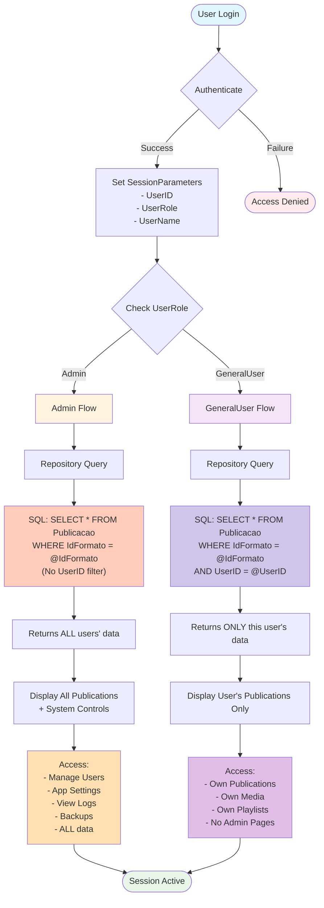
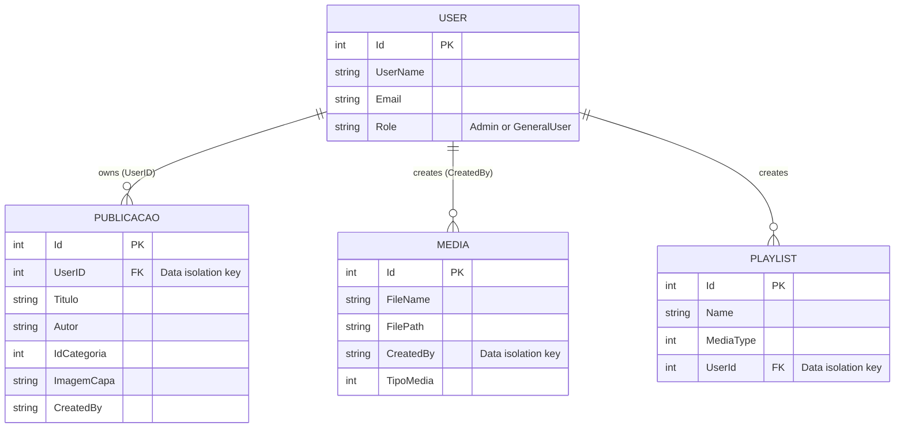
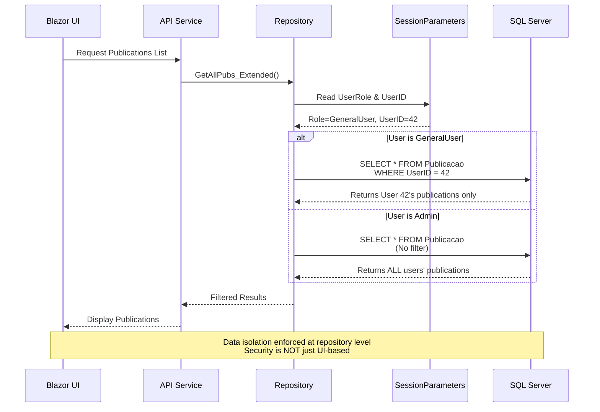
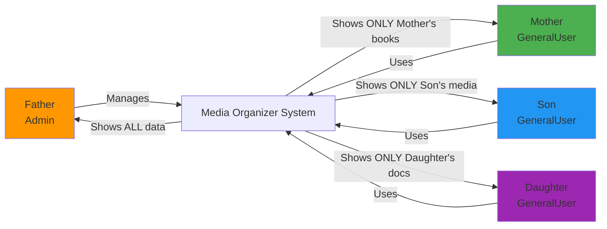
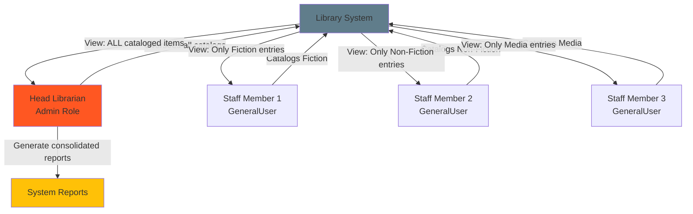
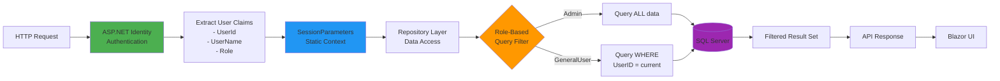

# User Role Data Flow Architecture

This diagram illustrates how data isolation works in the Media Organizer App based on user roles.

## Multi-User Data Flow with Role-Based Isolation



## Data Isolation at Entity Level



## Repository-Level Filtering Process



## Admin vs GeneralUser Feature Access

```mermaid
mindmap
  root((Media Organizer<br/>Multi-User System))
	Admin Role
	  Data Access
		ALL users' publications
		ALL users' media
		ALL playlists
		System-wide reports
	  Features
		User Management
		  Create users
		  Edit users
		  Delete users
		  Assign roles
		System Settings
		  App Settings
		  API Keys
		  Storage Options
		Monitoring
		  View Logs
		  Export Logs
		  Audit Trails
		Maintenance
		  Database Backup
		  Restore Operations
		  File Integrity Checks
		Lookup Tables
		  Categories
		  Formats
		  Publishers
	GeneralUser Role
	  Data Access
		OWN publications only
		OWN media only
		OWN playlists only
		Personal reports
	  Features
		Publications
		  Create own
		  Edit own
		  Delete own
		  Search/filter own
		Media
		  Upload own files
		  Edit own media
		  Create playlists
		  YouTube integration
		Documents
		  Edit .docx files
		  Print documents
		  Manage own files
		AI Tools
		  Chat/Conversations
		  Metadata retrieval
		  Author lookup
```

## Use Case Scenarios

### Scenario 1: Family Collection


### Scenario 2: Small Library


## Security Model



---

## Key Takeaways

1. **Data Isolation is Automatic**: The repository layer enforces data filtering based on `SessionParameters.UserRole` and `SessionParameters.UserID`.

2. **Security at Database Level**: Not just UI permissions—actual SQL queries are different for Admin vs GeneralUser.

3. **Admin Oversight**: Admin users can see and manage all data across all users, enabling system-wide management and reporting.

4. **User Privacy**: GeneralUser accounts only see their own data—other users' collections are invisible to them.

5. **Multi-Tenant Ready**: The architecture supports multiple independent users/teams using the same system instance.

---

## Code Reference

See these files for implementation details:
- `Application/AppGlobal/SessionParameters.cs` - User context storage
- `Application/Enums/Common.cs` - UserRole enum definition
- `MediaOrganizerApp.Persistence/Repositories/RawSQL_Generic/PublicacoesRepository.cs` - Repository filtering logic
- `Domain/Entities/Publicacao.cs` - Entity with UserID field
- `Web.Blazor/Pages/Admin/ManageUsers.razor` - Admin-only user management UI
